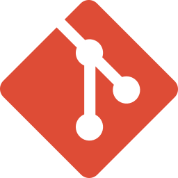

## 👋 Hey there

I build stuff with LLMs and spend an unreasonable amount of time getting them to admit when they don't know something. Mostly Python and TypeScript, usually on Linux, with Claude Code or Codex open in the other window.

- 💬 Ask me about RAG, evals, or getting LLMs to stop making up numbers
- 📫 bilalirfancontact@gmail.com
 

## 🔨 Featured

**[AskMyDoc](https://github.com/BilalIrfanContact/AskMyDoc)**: ask a company's 10-K a question and get an answer you can actually check. It does its math with a calculator, checks every number against the filing, and says "not in the document" instead of making something up. [Case study →](https://www.bilalirfanportfolio.online/projects/askmydoc)
 

## 🌱 Contributions

**[bulwark-mcp](https://github.com/churik5/bulwark-mcp/pull/7)**: a proxy that catches prompt injection before it reaches your AI agent. I made its errors a lot friendlier when Ollama isn't running. Merged ✅
 

## 🛠️ Tech Stack

### AI / ML
<table style="border:none;border-collapse:collapse;">
  <tr>
    <td align="center" width="96" style="border:none;"> OpenAI</td>
    <td align="center" width="96" style="border:none;"> Gemini</td>
    <td align="center" width="96" style="border:none;"> Chroma</td>
  </tr>
</table>

### Backend
<table style="border:none;border-collapse:collapse;">
  <tr>
    <td align="center" width="96" style="border:none;"> Python</td>
    <td align="center" width="96" style="border:none;"> FastAPI</td>
    <td align="center" width="96" style="border:none;"> Django</td>
    <td align="center" width="96" style="border:none;"> Flask</td>
  </tr>
</table>

### Frontend
<table style="border:none;border-collapse:collapse;">
  <tr>
    <td align="center" width="96" style="border:none;"> Next.js</td>
    <td align="center" width="96" style="border:none;"> React</td>
    <td align="center" width="96" style="border:none;"> TypeScript</td>
    <td align="center" width="96" style="border:none;"> JavaScript</td>
  </tr>
</table>

### Databases
<table style="border:none;border-collapse:collapse;">
  <tr>
    <td align="center" width="96" style="border:none;"> PostgreSQL</td>
    <td align="center" width="96" style="border:none;"> Supabase</td>
    <td align="center" width="96" style="border:none;"> MongoDB</td>
  </tr>
</table>

### Tools
<table style="border:none;border-collapse:collapse;">
  <tr>
    <td align="center" width="96" style="border:none;"> Claude Code</td>
    <td align="center" width="96" style="border:none;"> Codex</td>
    <td align="center" width="96" style="border:none;"> Git</td>
    <td align="center" width="96" style="border:none;"> Linux</td>
    <td align="center" width="96" style="border:none;"> Vercel</td>
  </tr>
</table>
 

## 🌐 Find me

  <a href="https://www.bilalirfanportfolio.online"><b>Portfolio</b></a>
  &nbsp;&nbsp;&nbsp;&nbsp;
  
  &nbsp;&nbsp;&nbsp;&nbsp;
  
  &nbsp;&nbsp;&nbsp;&nbsp;
  
  &nbsp;&nbsp;&nbsp;&nbsp;
  

